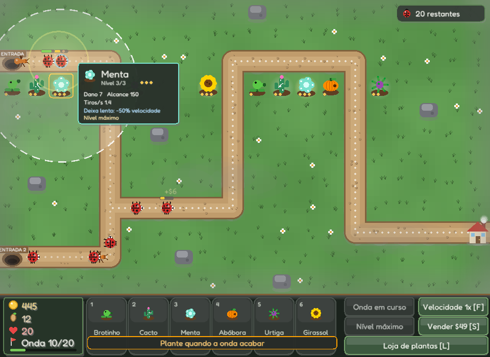
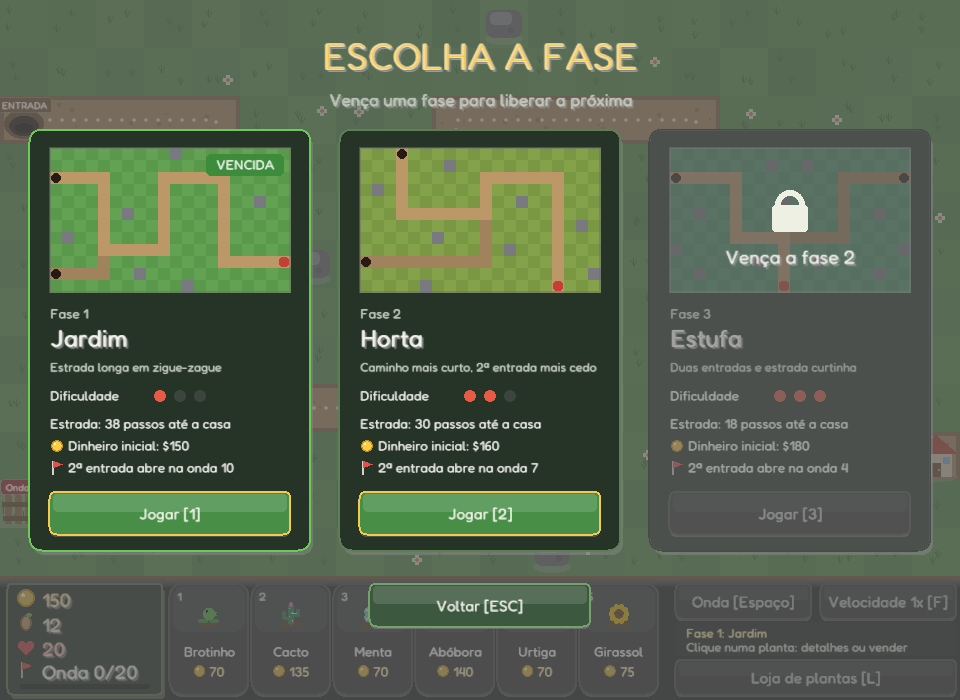

# Projeto PIF – Tower Defense

Jogo de **tower defense 2D** feito em **C** com a biblioteca **[raylib](https://www.raylib.com/)**.



O jogador constrói torres na grama, ao lado de uma estrada, para impedir que ondas de inimigos cheguem até a base. Os inimigos seguem a estrada, e a rota é calculada com **BFS (busca em largura)**. **Não é possível construir torres na estrada.**

---

## Objetivo

Sobreviver às **20 ondas** de inimigos sem perder todas as **20 vidas**.

- Cada inimigo que chega à base tira 1 vida (o tanque tira 5).
- Cada inimigo derrotado dá dinheiro.
- Ao fim de cada onda, o jogador ganha um bônus em dinheiro.
- **Só dá para plantar quando a onda acaba.** Ao começar uma onda, o modo de plantar é cancelado, os botões das plantas ficam apagados com "Aguarde", as teclas `1` a `6` não funcionam e aparece o aviso "Plante quando a onda acabar". Melhorar e vender continuam liberados.
- **Cada fase tem uma segunda entrada** que abre numa onda definida (onda 10 no Jardim, 7 na Horta e 4 na Estufa). Até lá ela aparece fechada, coberta de mato e com uma placa com o número da onda, e já não aceita plantas. Depois que abre, os inimigos saem alternadamente pelas duas entradas. O jogo avisa uma onda antes.

---

## Fases



O jogo tem **3 fases**, escolhidas numa tela própria (botão **Jogar** ou `Enter` no menu, depois `1`, `2` ou `3`). **Vencer uma fase libera a próxima.**

| Fase | Mapa | Estrada | 2ª entrada | Dinheiro inicial | Vida das pragas |
|------|------|---------|------------|------------------|-----------------|
| 1. Jardim | Zigue-zague longo, entradas à esquerda | 38 passos | Onda 10 | $150 | Normal |
| 2. Horta | Estrada desce do topo, caminho mais curto | 30 passos | Onda 7 | $160 | Normal |
| 3. Estufa | Duas entradas, uma de cada lado, que se encontram no meio | 18 passos | Onda 4 | $180 | −15% (para compensar a estrada curtíssima) |

Cada fase tem uma cor de grama diferente. Ao vencer, a tela de vitória oferece **Próxima fase**; ao perder, **Tentar de novo**. As duas também têm **Escolher fase**, que aparece ainda na tela de pausa.

As fases ficam na tabela `LEVELS` do código. Para criar uma fase nova, basta desenhar outro mapa em texto e escolher os números de dificuldade (`secondWave`, `hpMult`, `startMoney`) e aumentar `LEVEL_COUNT`.

---

## Interface

Tudo é desenhado com as formas do raylib (círculos, retângulos arredondados, linhas), sem nenhuma imagem externa:

- **Fonte:** os textos usam a **Fredoka**, uma fonte arredondada que combina com o tema de jardim. Ela fica em `fonts/Fredoka.ttf` (licença livre SIL Open Font License, em `fonts/OFL.txt`) e é suavizada com mipmaps. O raylib só lê o peso mais fino desse arquivo, então o jogo simula um negrito desenhando o texto com um pequeno deslocamento (mais forte nos títulos). Graças a ela, os textos do jogo têm os acentos do português (Abóbora, Nível, Próxima onda...). Se a pasta `fonts/` não estiver junto do jogo, ele usa a Segoe UI do Windows e, sem ela, a fonte padrão do raylib (que não tem acentos).
- **Mapa de jardim:** grama com manchas naturais (geradas com *value noise*) e tufos de capim balançando com o vento, florzinhas, pedras com sombra e sombras de nuvens passando devagar. A estrada é desenhada como uma faixa contínua, com curvas arredondadas, borda, sombra e pedrinhas. A base é uma **casinha** com fumaça saindo da chaminé, que pisca em vermelho quando perde vida, e as pragas saem de **tocas**. Pontinhos animados mostram o caminho calculado pela BFS.
- **Plantas animadas:** balançam de leve, dão um tranco para trás ao atirar (com um brilho no disparo) e crescem um pouco a cada nível. No nível 2 ganham uma aura prateada e no nível 3 uma aura dourada que pulsa e solta brilhinhos.
- **Um tiro para cada planta:** semente com rastro (Brotinho), espinho (Cacto), floquinho de gelo girando (Menta), mini-abóbora voando em arco com sombra (Abóbora), gota de veneno (Urtiga) e raio de sol (Girassol).
- **Pragas animadas:** besouro (normal), formiga (rápida) e caracol gigante (chefe), com perninhas que se mexem e viram na direção em que andam. Piscam em branco ao levar dano, e a barra de vida aparece quando estão feridas. Inimigos lentos ganham um anel azul, e envenenados soltam bolhas verdes.
- **Barra inferior:** painel com ícones de moeda, semente, coração e bandeira, mais uma barra de progresso da onda. Os botões das plantas mostram o desenho, o nome e o preço. Passar o mouse num botão mostra uma **dica** com os atributos.
- **Planta selecionada:** um cartão ao lado dela mostra o nível, o dano, o alcance, os tiros por segundo e o custo do próximo nível.
- **Efeitos:** sistema de partículas com faíscas ao acertar, nuvenzinha de poeira quando a praga morre e explosão laranja da abóbora. "+$5" sobe quando uma praga morre. Quando uma praga chega na casa, a tela treme e as bordas ficam vermelhas; com 5 vidas ou menos, as bordas pulsam em vermelho como alerta.
- **Começo de onda:** uma faixa entra deslizando com "ONDA 5" e um aviso (quantas pragas vêm, nova entrada aberta ou, nas ondas 5, 10, 15 e 20, **"Chefe: caracol gigante!"** em vermelho). Durante a onda, um contador no canto superior direito mostra quantas pragas faltam.
- **Telas** de menu (com tabela de controles), pausa, loja, tutorial, fim de jogo e vitória em painéis arredondados com botões clicáveis.

---

## Controles

| Tecla / Mouse        | Ação                                        |
|----------------------|---------------------------------------------|
| `1` a `6`            | Escolher o tipo de torre para construir     |
| `L`                  | Abrir / fechar a loja de torres             |
| Clique esquerdo      | Construir torre / selecionar torre          |
| Clique direito       | Cancelar seleção                            |
| `U`                  | Melhorar a planta selecionada (a partir da onda 5) |
| `S`                  | Vender a torre selecionada (70% do valor)   |
| `Espaço`             | Iniciar a próxima onda                      |
| `F`                  | Alternar velocidade (1x / 2x)               |
| `D`                  | Mostrar o mapa de distâncias da BFS         |
| `P` / `Esc`          | Pausar                                      |
| `Enter`              | Abrir a escolha de fase / próxima fase / tentar de novo |
| `1` `2` `3` (na escolha de fase) | Jogar a fase                     |

---

## Plantas (torres)

| Planta | Custo | Alcance | Tiros/s | Dano | Especial                        | Como obter     |
|--------|-------|---------|---------|------|---------------------------------|----------------|
| Brotinho | $70   | 120 px  | 1,6     | 10   | Barata e rápida                 | Já liberada    |
| Cacto  | $135  | 260 px  | 0,5     | 45   | Alcance longo, muito dano       | Já liberada    |
| Menta  | $70   | 100 px  | 1,0     | 4    | Reduz a velocidade em 50%       | Loja: 4 sementes  |
| Abóbora | $140  | 130 px  | 0,6     | 22   | Dano em área (raio de 55 px)    | Loja: 14 sementes |
| Urtiga | $70   | 110 px  | 1,0     | 2    | Veneno: 8 + 3% da vida máxima por segundo, durante 3 s | Loja: 6 sementes  |
| Girassol | $75   | 150 px  | 6,0     | 3    | Atira muito rápido              | Loja: 10 sementes |

### Melhorias

As melhorias ficam **bloqueadas até a onda 5**. Ao terminar a onda 4, o jogo pausa e mostra um **tutorial** explicando como melhorar as plantas. Depois disso o botão "Melhorar" (ou a tecla `U`) passa a funcionar.

- Cada planta pode ser melhorada até o **nível 3** (as bolinhas douradas embaixo dela mostram o nível).
- Cada nível aumenta o dano (e o veneno) em **40%**, o alcance em **25%** e os tiros por segundo em **20%** (constantes `UPG_DAMAGE`, `UPG_RANGE` e `UPG_FIRERATE`).
- Custo: nível 2 = preço da planta, nível 3 = 2× o preço.
- Vender devolve 70% de tudo o que foi gasto na planta, incluindo as melhorias.

A onda de liberação é configurável pela constante `UPGRADE_UNLOCK_WAVE` no código.

---

## Loja de plantas

O jogo tem duas moedas:

| Moeda        | Para que serve                         | Como ganhar                                              | Dura           |
|--------------|----------------------------------------|----------------------------------------------------------|----------------|
| **Dinheiro** | Construir e melhorar torres na partida | Derrotar inimigos e completar ondas                      | Só na partida  |
| **Sementes**    | Liberar novas torres na loja           | +1 por onda, +3 extras em onda de chefe, +2 por tanque   | Para sempre    |

- Abra a loja com **`L`** ou com o botão **"Loja de plantas"**. Também dá para abrir pelo menu inicial.
- O jogo fica **pausado** enquanto a loja está aberta.
- Torres bloqueadas aparecem com um **cadeado** na barra inferior. Clicar nelas abre a loja.
- Depois de liberada, a torre fica disponível em todas as partidas seguintes.

### Progresso salvo

As sementes e as torres liberadas são salvas no arquivo **`progresso.txt`**, criado na pasta onde o jogo roda:

```
sementes 7
torres 1 1 0 1 0 0
fases 1
```

Cada número da linha `torres` indica se a torre de mesma posição (1 a 6) está liberada (`1`) ou não (`0`). A linha `fases` guarda quais fases já foram vencidas (bit 1 = Jardim, bit 2 = Horta, bit 4 = Estufa; por exemplo, `3` = Jardim e Horta vencidos). Arquivos antigos, sem essa linha, continuam funcionando. Para **zerar o progresso**, é só apagar esse arquivo.

## Inimigos

| Inimigo | Vida      | Velocidade | Recompensa | Quando aparece               |
|---------|-----------|------------|------------|------------------------------|
| Normal  | base      | média      | $5         | Todas as ondas               |
| Rápido  | 60% base  | alta       | $6         | A partir da onda 3           |
| Tanque  | 8× base   | baixa      | $40        | Chefe a cada 5 ondas         |

A vida base cresce **20,5% a cada onda** (constantes `ENEMY_BASE_HP` e `HP_GROWTH`) e ainda é multiplicada pelo `hpMult` da fase.

### Balanceamento

Os preços, os bônus de melhoria, o crescimento da vida dos inimigos e a dificuldade de cada fase foram ajustados com um **simulador**. Ele usa o próprio código do jogo, sem janela, e um "bot" que joga as 20 ondas sozinho (plantando entre as ondas e melhorando a partir da onda 5) com 7 estratégias diferentes. Resultado com os valores atuais:

| Estratégia do bot          | 1. Jardim          | 2. Horta           | 3. Estufa          |
|----------------------------|--------------------|--------------------|--------------------|
| Só Brotinho                | Perde na onda 20   | Perde na onda 20   | Vence (11 vidas)   |
| Brotinho + Cacto           | Vence (1 vida)     | Perde na onda 20   | Perde na onda 19   |
| Brotinho + Menta           | Perde na onda 19   | Perde na onda 18   | Perde na onda 19   |
| Brotinho + Abóbora         | Vence (9 vidas)    | Vence (3 vidas)    | Vence (7 vidas)    |
| Brotinho + Urtiga          | Vence (16 vidas)   | Perde na onda 18   | Perde na onda 16   |
| Brotinho + Girassol        | Vence (3 vidas)    | Vence (8 vidas)    | Vence (8 vidas)    |
| Todas as plantas misturadas| Vence (3 vidas)    | Vence (1 vida)     | Perde na onda 18   |
| **Total de vitórias**      | **5 de 7**         | **3 de 7**         | **3 de 7**         |

Antes desta versão (crescimento de 20% e só a fase Jardim), 6 de 7 estratégias venciam o Jardim com 10 a 18 vidas sobrando. Um jogador de verdade, que escolhe bem os lugares e usa a Menta nas curvas, costuma se sair melhor que o bot.

---

## Como compilar e executar

### Pré-requisito
Instalar o raylib para Windows (o instalador oficial em <https://www.raylib.com/> já inclui o compilador `w64devkit` e o Notepad++ configurado).

### Opção 1 – Notepad++ do raylib
Abra `Projeto-PIF-TowerDefense.c` no Notepad++ que vem com o raylib e pressione **F6**.

### Opção 2 – Linha de comando
```bash
C:\raylib\w64devkit\bin\gcc Projeto-PIF-TowerDefense.c -o Projeto-PIF-TowerDefense.exe -O2 -Wall -std=c99 -IC:\raylib\raylib\src -LC:\raylib\raylib\src -lraylib -lopengl32 -lgdi32 -lwinmm
```

Depois execute (a pasta `fonts/` precisa ficar junto do `.exe` para o jogo usar a fonte Fredoka):
```bash
Projeto-PIF-TowerDefense.exe
```

---

## Estrutura do código

Todo o jogo está em `Projeto-PIF-TowerDefense.c`, organizado em seções:

| Seção            | Responsabilidade                                                   |
|------------------|--------------------------------------------------------------------|
| Configurações    | Tamanho da grade, limites, dinheiro e vidas iniciais, mapa em texto |
| Tipos            | `structs` e `enums` de torres, inimigos, projéteis, efeitos e estados |
| Progresso e loja | `SaveProgress`, `LoadProgress`, `AddSeeds`, `BuyTower`, `OpenShop`  |
| Mapa e BFS       | `LoadMap`, `ComputeDistances` (BFS) e `CanPlace`                   |
| Jogo             | Ondas, spawn, movimento, mira, projéteis, dano em área e veneno    |
| Desenho          | Mapa, torres, inimigos, interface, loja e telas de menu/pausa/fim  |
| `main`           | Game loop e máquina de estados                                     |

### Conceitos de programação aplicados

- **Game loop**: a cada frame o jogo lê a entrada, atualiza e desenha.
- **Máquina de estados**: menu → jogando ⇄ pausado / loja / tutorial → fim de jogo / vitória.
- **Persistência em arquivo**: `fopen` / `fprintf` / `fscanf` para salvar e carregar as sementes e as torres liberadas.
- **Dados das torres em tabela**: cada torre é uma linha de `TOWER_INFO`. Para criar uma torre nova, basta adicionar uma linha, sem mexer na lógica.
- **Matriz (grid)**: o mapa é uma matriz `ROWS × COLS` de tiles.
- **BFS (busca em largura)**: parte da base e, andando só pela estrada, calcula a distância de cada tile até ela. Os inimigos sempre andam para o vizinho com menor distância.
- **Validação de construção**: cada tile tem um tipo (grama, estrada, pedra ou torre). `CanPlace` só deixa construir na grama livre e mostra uma mensagem quando o jogador tenta construir na estrada.
- **Pools de entidades**: inimigos e projéteis ficam em vetores de tamanho fixo e os slots são reaproveitados.
- **Vetores 2D**: movimento, distância, mira (`atan2f`) e projéteis teleguiados usando `raymath`.

### Mapa

O mapa é definido como texto no início do código e pode ser editado facilmente:

```
.  grama (pode construir torres)
=  estrada (os inimigos andam por aqui; não pode construir)
#  pedra (não dá para construir nem passar)
S  entrada dos inimigos
T  segunda entrada (abre na onda secondWave da fase)
+  estrada da segunda entrada (fechada até abrir, mas já não aceita plantas)
B  base
```

A estrada da segunda entrada se junta à estrada principal. Como a BFS parte da base, os inimigos das duas entradas encontram o caminho sozinhos, sem nenhum código extra de rota. Cada fase tem o seu mapa na tabela `LEVELS`.

---

## Possíveis melhorias

- Carregar as fases a partir de arquivos `.txt`, em vez de deixá-las no código
- Sprites e animações no lugar das formas geométricas
- Efeitos sonoros e música
- Salvar recorde em arquivo
- Comprar melhorias permanentes na loja (ex.: +10% de dano para todas as torres)
- Usar A* no lugar da BFS

---

## Tecnologias

- Linguagem **C (C99)**
- **raylib 5** (gráficos, entrada e janela)
- **raymath** (operações com vetores)
